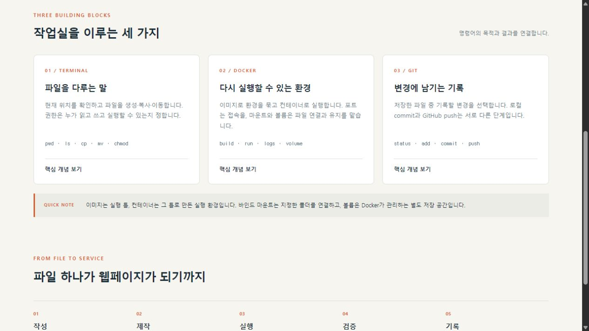
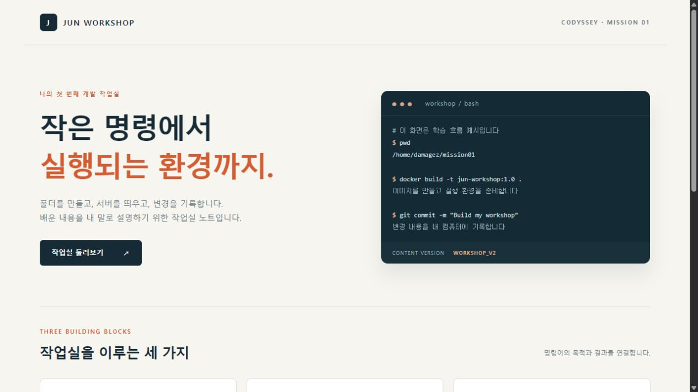
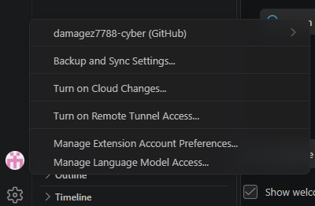
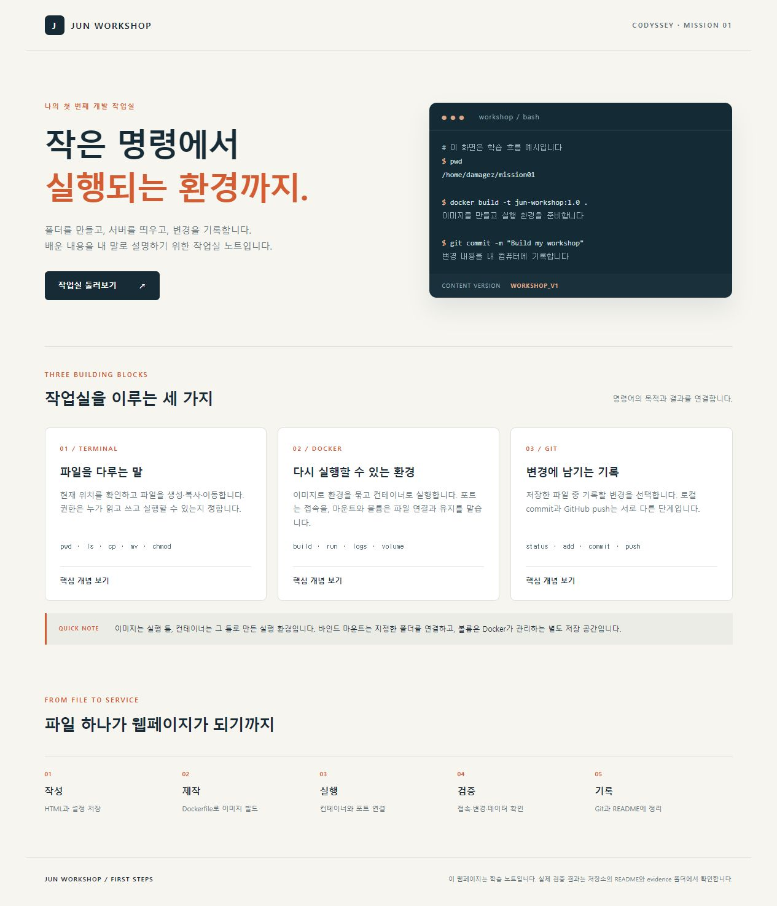
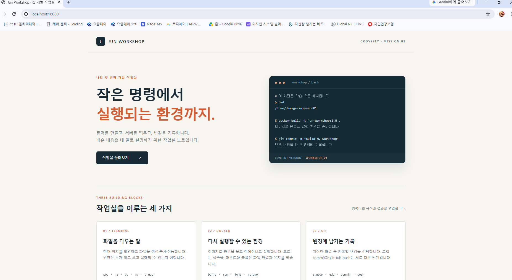

# 강준권의 첫 개발 작업실 Jun Workshop

**제출자: 강준권**

코디세이 개인 필수 미션 **내 컴퓨터에 개발자용 작업실 꾸미기**의 제출 프로젝트입니다. Ubuntu에서 개발 작업 환경을 구성하고, 커스텀 NGINX 이미지로 Jun Workshop 웹페이지를 실행했습니다. 이 문서는 강준권의 제출 프로젝트가 구현한 내용과 Ubuntu CLI, 파일·디렉터리 권한, Dockerfile, 포트 매핑, 바인드 마운트, 볼륨의 실제 검증 결과를 설명합니다.

**현재 상태:** 실행 검증 10개 항목과 로컬 Git 설정, GitHub 저장소 업로드를 확인했습니다. 2026-11-03 기준 저장소는 공개 상태입니다. VS Code의 GitHub 로그인·프로젝트 연결 화면과 주소창이 포함된 Chrome 접속 화면을 증거로 제공합니다. 실행 검증 결과와 코디세이의 최종 평가 결과는 별도로 구분합니다.

이 저장소에는 본 미션을 위해 구성한 프로젝트와 검증 자료를 포함합니다. 프로젝트 코드 작성과 실행 검증에는 AI 도구를 활용했습니다. 지원 범위는 [별도 문서](docs/작성지원_및_검증범위.txt)에 정리했으며, 원문 로그의 `actor=jarvis-assisted`는 AI 도구의 지원으로 실행한 기록임을 나타냅니다.

**검증 범위:** 아래의 ‘확인’은 제출자료와 실제 실행 기록을 대조한 결과입니다. Dockerfile 기반 이미지 빌드·실행, 포트 접속, 바인드 마운트 변경 반영 및 볼륨 데이터 유지를 검증했습니다. 선택 보너스 5개 항목의 수행 증거는 포함하지 않습니다.

## 사전평가 지적 항목 보완: #9 · #13 · #16 · #18

제출자: **강준권**. 아래는 제출자료의 핵심 증거를 본문에서 직접 확인할 수 있도록 정리한 보완입니다. 사전평가 재통과나 동료평가 완료를 주장하는 표시가 아닙니다.

### 평가 항목 #13: 네트워크 네임스페이스와 호스트·컨테이너 포트의 분리

이 프로젝트가 사용하는 Linux Docker의 기본 브리지 네트워크에서 **네트워크 네임스페이스(network namespace)**는 컨테이너의 네트워크 인터페이스·IP 주소·라우팅 테이블·포트와 소켓 공간을 호스트 및 다른 컨테이너와 구분하는 Linux 격리 기능입니다. 쉽게 말해 같은 컴퓨터 안에서도 각 컨테이너가 별도의 네트워크 공간을 갖는 것입니다. 이렇게 분리하면 여러 컨테이너의 웹 서버가 각각 **80번 포트**를 사용해도 같은 네임스페이스에서 동일 주소·포트를 점유하는 충돌을 피할 수 있고, 컨테이너 안 서비스의 포트가 호스트의 같은 번호에 자동으로 공개되지 않습니다. 따라서 컨테이너 안의 `localhost:80`과 호스트의 `localhost:80`은 같은 접속 지점이 아닙니다. 이 프로젝트의 `-p 127.0.0.1:18080:80`은 Docker 호스트의 루프백 주소 **127.0.0.1:18080**으로 들어온 요청을 컨테이너의 NGINX **80번**으로 전달하도록 포트를 매핑합니다. 즉 네트워크 공간의 분리를 유지하면서 필요한 서비스에 접속할 입구를 명시하는 설정이며, 호스트 쪽 18080번은 같은 주소·프로토콜에서 중복 점유할 수 없습니다. 여기서 호스트는 Docker 엔진이 실행되는 WSL Ubuntu를 뜻하며, Windows 브라우저 접속은 해당 WSL 연결 경로도 거칩니다. 이는 기본 브리지 방식에 대한 설명이고, 호스트와 네트워크를 공유하는 `--network host` 방식과는 구분합니다.

프로젝트 접속 흐름을 짧게 쓰면 **브라우저 → 호스트 127.0.0.1:18080 → Docker 포트 매핑 → 컨테이너 NGINX:80**입니다. `-p`는 이 연결을 만드는 실행 옵션이며, Dockerfile의 `EXPOSE 80` 선언만으로 호스트 포트가 열리는 것은 아닙니다. 기존 [18080·18081 실제 접속 로그](evidence/20261102T170206Z/05_ports.txt)는 각 호스트 포트를 통해 웹 응답을 받은 기록입니다. 이번 보완은 이 결과의 구조적 이유를 설명한 문서 수정이며 새로운 네임스페이스 측정 실험을 했다는 뜻은 아닙니다.

공식 근거: [Docker 네트워킹 개요](https://docs.docker.com/engine/network/), [Docker 포트 공개와 매핑](https://docs.docker.com/engine/network/port-publishing/).

### 평가 항목 #9: Git 사용자 설정·기본 브랜치·원격 연결

다음은 현재 Ubuntu 프로젝트 폴더에서 다시 조회한 **실제 출력**입니다. 과거 [08_git.txt](evidence/08_git.txt)는 origin 등록 전 기록이므로 당시의 빈 remote 출력을 사후에 고치지 않고 새 로그를 추가했습니다.

```text
$ git config --local user.name
damagez7788-cyber
exit_code=0

$ git config --local user.email
350343401+damagez7788-cyber@users.noreply.github.com
exit_code=0

$ git config --local init.defaultBranch
main
exit_code=0

$ git remote -v
origin	https://github.com/damagez7788-cyber/codyssey-mission01.git (fetch)
origin	https://github.com/damagez7788-cyber/codyssey-mission01.git (push)
exit_code=0

$ git remote get-url origin
https://github.com/damagez7788-cyber/codyssey-mission01.git
exit_code=0

$ git branch --show-current
main
exit_code=0
```

`git config --local user.name`은 이 저장소의 작성자 이름, `user.email`은 작성자 이메일, `init.defaultBranch`는 기본 브랜치 설정을 조회합니다. `remote -v`의 `fetch`는 내려받을 주소, `push`는 올릴 주소입니다. `branch --show-current`의 `main`은 현재 작업 브랜치입니다. 종료 코드 0은 각 조회 명령이 성공했다는 뜻입니다. 이메일은 공개용 GitHub noreply 주소입니다. [Git 설정·remote 전체 실측 로그](evidence/10_git_config_remote.txt).

### 평가 항목 #16: 포트 충돌 진단·해제·대체 실행

포트 오류가 나면 먼저 **어떤 프로그램/컨테이너가 해당 포트를 사용하는지 확인**하고, 본인 실습 서비스일 때만 대상을 지정해 중지합니다. 다음은 절차 안내이며 중지·프로세스 종료 명령을 이번 점검에서 실행한 기록은 아닙니다.

1. **운영체제의 사용 프로세스 확인**

```bash
sudo ss -ltnp '( sport = :18080 )'
```

뜻: 관리 권한으로 TCP 수신 포트와 프로세스를 확인합니다. `-l` 수신 중, `-t` TCP, `-n` 숫자 표시, `-p` 프로세스 표시, `sport = :18080`은 로컬 18080번만 조회합니다. 출력 행의 `users`, 프로그램 이름, `pid`를 확인합니다. 제목 줄만 나오면 해당 시점에 조회된 수신 소켓이 없다는 뜻입니다.

2. **Docker 컨테이너인지 대조**

```bash
sudo docker ps --filter publish=18080 --format 'table {{.Names}}	{{.Ports}}	{{.Status}}'
```

뜻: 실행 중인 컨테이너 가운데 18080 포트에 관련된 항목의 이름·포트 매핑·상태를 표시합니다. `PORTS` 열에서 호스트의 `18080->80/tcp` 매핑을 직접 대조합니다. 필요하면 `sudo docker ps --format 'table {{.Names}}	{{.Ports}}'`로 전체 실행 목록의 매핑을 확인합니다.

3. **본인 실습 컨테이너가 점유한 경우 해제**

아래의 `<...>`는 설명용 자리표시자입니다. 진단 결과로 확인한 실제 이름·PID로 바꿔야 하며 그대로 실행하는 명령이 아닙니다.

```bash
sudo docker stop <확인한_본인_컨테이너명>
sudo ss -ltnp '( sport = :18080 )'
sudo docker ps --filter publish=18080
```

`docker stop`은 이름으로 지정한 컨테이너를 정상 중지합니다. 중지 후 ss와 docker ps를 다시 확인해 점유가 해제됐는지 검증합니다. 컨테이너가 아닌 본인 프로세스라면 아래처럼 정체를 먼저 확인하고 정상 종료를 요청할 수 있습니다.

```bash
ps -p <확인한_PID> -o pid,comm,args
sudo kill -TERM <확인한_본인_PID>
sudo ss -ltnp '( sport = :18080 )'
```

`ps -p`는 해당 PID의 프로그램과 실행 인자를 확인하고, `kill -TERM`은 지정한 본인 프로세스에 정상 종료 신호를 보냅니다. 다른 사람/시스템 서비스나 Docker의 프록시를 임의로 종료하지 않습니다. Docker 서비스는 해당 컨테이너를 중지하는 방법을 우선합니다.

4. **기존 서비스를 유지해야 하면 대체 포트 사용**

```bash
sudo ss -ltnp '( sport = :18090 )'
sudo env WORKSHOP_PORT=18090 WORKSHOP_CONTAINER=jun-workshop-alt-18090 bash scripts/run.sh
curl --fail --silent --show-error --retry 10 --retry-all-errors --retry-delay 1 --max-time 3 http://localhost:18090/health
curl --fail --include http://localhost:18090/
```

`env`로 해당 실행에만 환경 변수를 전달합니다. `WORKSHOP_PORT`는 호스트 포트, `WORKSHOP_CONTAINER`는 새 컨테이너 이름입니다. `bash scripts/run.sh`는 기존 실행 도우미로 이미지를 빌드하고 지정한 포트로 실행합니다. 이미지 안 서버의 80번은 유지합니다. 재현 시 **예상** 결과는 `/health`의 `workshop-ready`와 본문의 `WORKSHOP_V1`, HTTP 200입니다. 이 대체 실행 예시를 실제 새 실행 결과라고 표시하지 않습니다.

**이번 추가 점검의 실제 출력** (2026-11-03T13:36:37.753804+09:00):

```text
$ ss -ltnp '(' sport = :18080 ')'
State Recv-Q Send-Q Local Address:Port Peer Address:PortProcess
exit_code=0

$ ss -ltnp '(' sport = :18090 ')'
State Recv-Q Send-Q Local Address:Port Peer Address:PortProcess
exit_code=0

$ docker ps --filter publish=18080 --format 'table {{.Names}}	{{.Ports}}	{{.Status}}'
NAMES     PORTS     STATUS
exit_code=0
```

해석: 점검 당시 18080·18090은 ss 출력에 제목만 있었고, 18080을 공개하는 실행 중 Docker 컨테이너도 없었습니다. 이번에 새 포트 충돌을 겪었다거나 서비스를 종료했다고 기록하지 않습니다. [현재 포트 진단 전체 로그](evidence/11_port_diagnostics.txt).

### 평가 항목 #18: 실제 트러블슈팅 2건

두 사례는 원래 검증 실행 중 실제 발생한 문제입니다. 각각 **문제 → 원인 가설 → 검증 → 조치 → 재검증 결과 → 관련 로그** 순서로 정리했습니다. 의도한 권한 거부 실험은 아래 두 사례 수에 포함하지 않았습니다. 작성·실행 지원 범위와 실행 주체 표시는 원래 기록대로 보존합니다.

### 사례 1: 빌드 성공 후 바탕 이미지 태그 조회 실패

**문제:** 최초 검증에서 커스텀 이미지 build는 성공했지만 `nginx:stable-alpine` 조회가 종료 코드 1로 실패했습니다.

```text
$ docker image inspect nginx:stable-alpine
[]
Error response from daemon: No such image: nginx:stable-alpine
exit_code=1
```

**원인 가설:** BuildKit이 FROM을 빌드용으로 해석한 것과 Docker 엔진에 이름 있는 기본 이미지 태그가 등록된 것은 별개일 수 있습니다. 빌드 성공만으로 기본 태그 조회 성공까지 가정한 점을 확인했습니다.

**검증:** [첫 실패 원문](evidence/20261102T165758Z/04_build.txt)에서 커스텀 이미지 build·조회 성공과 기본 이미지 조회 실패가 연속으로 기록돼 있습니다. 의도적으로 만든 오류가 아닙니다.

**조치:** 검증 스크립트에 `docker pull nginx:stable-alpine`을 명시해 기본 이미지를 받은 뒤 build와 inspect를 수행하도록 보완했습니다. `pull`은 이미지 받기, `build`는 Dockerfile로 제작하기, `image inspect`는 등록된 이미지의 세부 정보 확인입니다.

**재검증 결과(실제 출력 발췌):**

```text
$ docker pull nginx:stable-alpine
stable-alpine: Pulling from library/nginx
Digest: sha256:0e52bd054126cdc040b1276c0af347aeb02a41b9cfe305d6094767ac30e97949
Status: Image is up to date for nginx:stable-alpine
docker.io/library/nginx:stable-alpine
exit_code=0
```


```text
$ docker image inspect nginx:stable-alpine
[
    {
        "Id": "sha256:0e52bd054126cdc040b1276c0af347aeb02a41b9cfe305d6094767ac30e97949",
        "RepoTags": [
            "nginx:stable-alpine"
[긴 출력 중략]
exit_code=0
```

두 명령 모두 `exit_code=0`으로 성공했습니다. 정확한 이미지 ID·digest·빌드 출력은 [최종 빌드 원문](evidence/20261102T170206Z/04_build.txt)에서 확인할 수 있습니다.

### 사례 2: 컨테이너 생성 직후 웹 접속 초기화

**문제:** 두 번째 검증에서 컨테이너 run은 성공했지만, 즉시 요청한 HTTP 접속이 종료 코드 56으로 실패했습니다.

```text
$ curl --fail --silent --show-error --include http://127.0.0.1:18082/
curl: (56) Recv failure: Connection reset by peer
exit_code=56
```

**원인 가설:** 컨테이너 생성 직후 서버가 요청을 받을 준비가 끝나기 전에 curl이 실행됐을 가능성을 점검했습니다. 연결 초기화의 저수준 원인까지 확정하지는 않았습니다.

**검증:** [두 번째 실패 원문](evidence/20261102T170027Z/06_bind.txt)에 run 성공 직후 curl 실패가 기록돼 있습니다. 당시 출력은 `Connection reset by peer`, 즉 상대편에서 연결을 초기화했다는 뜻입니다.

**조치:** 먼저 `/health`가 응답할 때까지 상한을 둔 재시도를 수행한 다음 본문을 검사하도록 수정했습니다. `--retry 10`은 최대 10회 재시도, `--retry-all-errors`는 모든 오류를 재시도 대상으로 처리, `--retry-delay 1`은 재시도 사이 1초 대기, `--max-time 3`은 요청별 최대 3초입니다. `--fail`은 HTTP 오류를 실패로 처리하고 `--silent --show-error`는 진행 표시를 줄이되 오류를 보여 줍니다.

**재검증 결과(실제 출력 발췌):**

```text
$ curl --fail --silent --show-error --retry 10 --retry-all-errors --retry-delay 1 --max-time 3 http://127.0.0.1:18082/health
workshop-ready
curl: (56) Recv failure: Connection reset by peer
exit_code=0
```

위 stderr의 연결 초기화는 재시도 중 발생한 메시지입니다. 마지막에는 `workshop-ready`를 받고 종료 코드 0으로 성공했습니다. 오류 문구가 한 번 나타났다는 것과 최종 요청 실패를 구분합니다.

```text
$ curl --fail --silent --show-error --include http://127.0.0.1:18082/
HTTP/1.1 200 OK
Server: nginx/1.30.6
Date: Mon, 02 Nov 2026 17:02:39 GMT
Content-Type: text/html; charset=utf-8
Content-Length: 3938
Last-Modified: Mon, 02 Nov 2026 17:02:39 GMT
[긴 출력 중략]
exit_code=0
```

최종 HTTP 응답은 `200 OK`이고 종료 코드 0입니다. 원문 본문에서 변경 후 `WORKSHOP_V2`와 기존 COPY 컨테이너의 `WORKSHOP_V1` 유지도 확인했습니다. [최종 마운트·접속 원문](evidence/20261102T170206Z/06_bind.txt), [검사 통과 목록](evidence/20261102T170206Z/checks.json).

---

## 1 프로젝트 개요와 커스텀 내용

터미널·Docker·Git의 차이를 설명하는 한국어 작업실 노트 웹페이지를 만들었습니다. 외부 폰트·CDN·별도 JavaScript 라이브러리를 사용하지 않아, 웹 서버가 켜진 환경에서는 같은 정적 파일로 화면을 확인할 수 있습니다.

- 바탕 이미지: Docker Official Image `nginx:stable-alpine`.
- 커스텀 콘텐츠: 직접 작성한 HTML·CSS·JavaScript. 세 카드의 버튼을 누르면 핵심 설명이 바뀝니다.
- 커스텀 설정: UTF-8 웹 응답, `/health` 점검 경로, 수정 비교를 위한 `Cache-Control: no-store`.
- 컨테이너 서버 포트: **80**. 호스트의 **18080·18081**에 연결해 각각 접속했습니다.
- 실제 사용 이미지의 ID와 바탕 이미지 digest: [이미지 빌드·조회 로그](evidence/20261102T170206Z/04_build.txt).

`stable-alpine` 태그는 나중에 다른 이미지가 될 수 있습니다. 기록된 digest로 같은 바탕 이미지를 지정하거나 실제 사용 digest를 새 검증 로그에 함께 남깁니다.

## 2 실제 실행 환경

| 항목 | 확인 결과 |
| --- | --- |
| 실행 위치 | Windows WSL 2 안의 Ubuntu |
| Ubuntu | 26.04.1 LTS, Resolute |
| 커널 | 6.18.54.1-microsoft-standard-WSL2 |
| 셸 | Bash. 정확한 빌드 정보는 환경 로그 참조 |
| 터미널 실행 방식 | Windows에서 `wsl.exe --exec`로 CLI 명령 실행 |
| Docker | Docker Engine Community 29.9.2, 엔진 실행 확인 |
| Git | 2.53.0 |
| GitHub CLI | 기존 인증 계정의 API 조회 성공. 비밀 토큰을 출력·복사하지 않음 |
| 실제 프로젝트 경로 | `/home/damagez/codyssey-mission01` |
| 실행 지원 | `jarvis-assisted`. 권한 실험은 일반 사용자 `damagez`, Docker 검증은 root |

[환경 점검 명령과 실제 출력](evidence/20261102T170206Z/01_environment.txt), [로컬 Git 설정 및 GitHub CLI 계정 확인](evidence/08_git.txt), [실제 로컬 commit 이력](docs/git_history.md)

Docker Desktop 대신 Ubuntu 안에 Docker 공식 패키지 저장소의 Docker Engine을 설치해 사용했습니다. 기록된 실행에서는 엔진 작동을 확인했으며, Docker 그룹 권한이나 광범위한 사용자 권한을 새로 부여하지 않았습니다.

## 3 파일 구성

```text
Dockerfile                 이미지 제작 지시문
nginx/default.conf         웹 서버 설정과 /health 응답
site/index.html            화면 구조와 한국어 콘텐츠
site/styles.css            반응형 화면 스타일
site/app.js                카드 버튼의 개념 설명 전환
scripts/run.sh             이미지 제작 및 간단 실행
scripts/verify.py          실제 명령·출력을 저장하는 검증
scripts/observe_attach.py  exec와 attach 차이 관찰
docs/                      요구사항 대조·문제 해결·명령어 해석
evidence/                  실제 실행 로그·결과·웹 화면
```

## 4 평가자가 다시 실행하는 방법

Linux 또는 WSL의 Ubuntu에서 Docker 엔진이 실행 중이고 `docker info`가 성공하는 환경을 준비합니다. Docker 설치는 [공식 Ubuntu 설치 안내](https://docs.docker.com/engine/install/ubuntu/)를 기준으로 합니다. 다른 방식의 기존 Docker 설치와 무조건 중복 설치하지 않습니다.

저장소를 내려받은 뒤 **저장소 루트 폴더**에서 실행합니다. 아래 `.`은 현재 폴더를 뜻하므로 개인 PC의 절대 경로를 그대로 사용할 필요가 없습니다.

```bash
sudo docker build -t jun-workshop:1.0 .
sudo docker run -d --name jun-workshop-review \
  -p 127.0.0.1:18090:80 jun-workshop:1.0
curl --fail --silent --show-error --retry 10 \
  --retry-all-errors --retry-delay 1 --max-time 3 \
  http://localhost:18090/health
curl --fail --include http://localhost:18090/
```

- `build`: Dockerfile을 읽어 이미지 제작. `-t`: 이미지 이름·태그. 마지막 `.`: 현재 폴더를 빌드 자료로 사용.
- `run`: 새 컨테이너 생성·실행. `-d`: 백그라운드. `--name`: 이름. `-p`: 호스트 주소·포트를 컨테이너의 80번에 연결.
- `curl --include`: 요청한 주소의 HTTP 헤더와 본문 표시. `--fail`: HTTP 오류를 실패로 반환.
- 먼저 `/health`로 서버 준비 상태를 확인합니다. `--silent --show-error`는 진행 표시를 줄이고 오류는 표시하며, `--retry 10 --retry-all-errors`는 오류 시 최대 10회 재시도, `--retry-delay 1`은 재시도 간 1초 대기, `--max-time 3`은 각 요청의 최대 대기 3초입니다. 최종 요청까지 실패하면 서버 로그와 포트를 확인한 뒤 다음 단계로 진행합니다.
- 예상 확인 기준: 페이지에 `WORKSHOP_V1`과 작업실 콘텐츠가 있고, `/health`는 `workshop-ready`를 응답합니다. 위 명령은 재현 방법이며, 이 포트 18090의 출력은 별도로 실행한 증거가 아닙니다.

브라우저 주소는 `http://localhost:18090/`입니다. 이름이나 포트가 이미 사용 중이면 다른 학습용 이름·포트를 사용합니다. 기존 컨테이너를 일괄 삭제하지 않습니다. Docker를 이미 일반 사용자로 사용할 수 있으면 Docker 명령의 `sudo`를 생략할 수 있습니다.

자동 검증은 Linux 계정 `damagez`와 테스트 포트 **18080~18082가 비어 있는 환경**에서 실행했습니다.

```bash
sudo python3 scripts/verify.py --actor evaluator --owner "$(id -un)"
```

`--actor`는 실행 주체, `--owner`는 일반 사용자 권한 실험을 할 계정입니다. 검증은 전용 `.verification-lab`과 실행별 이름의 컨테이너·볼륨을 만듭니다. 기록용 writer 컨테이너만 중지·삭제하고, 생성한 나머지 컨테이너와 볼륨은 검증 후 확인할 수 있게 남깁니다. 이미 시험 컨테이너가 포트를 사용 중이면 해당 실행의 목록을 확인한 뒤 명시적으로 중지하거나 다른 환경에서 재현합니다. `.verification-lab`은 Git과 Docker 빌드 자료에서 제외했습니다.

## 5 필수 수행 항목과 실제 증거

| 요구사항 | 상태 | 결과 위치 |
| --- | --- | --- |
| 현재 위치, 숨김 목록, 생성·복사·이동·이름변경·삭제·내용 읽기 | 확인 | [새 CLI 로그](evidence/20261102T170206Z/02_linux.txt) |
| 빈 파일 만들기 | 확인 | 위 로그의 `touch empty.txt` 및 목록 |
| 파일 1개 권한 변경 전후 | 확인 | 파일 `644 → 600`, 위 CLI 로그 |
| 디렉터리 1개 권한 변경 전후 | 확인 | `755 → 600 → 755`, 일반 사용자 진입 거부와 복원 확인 |
| Docker 버전·데몬 상태 | 확인 | [환경 로그](evidence/20261102T170206Z/01_environment.txt) |
| 이미지 다운로드·목록 | 확인 | [컨테이너 로그](evidence/20261102T170206Z/03_containers.txt), [pull·빌드 로그](evidence/20261102T170206Z/04_build.txt) |
| hello-world, Ubuntu 내부 ls·echo | 확인 | [컨테이너 로그](evidence/20261102T170206Z/03_containers.txt) |
| exec 종료와 attach 분리·유지 | 확인 | 위 로그의 EXEC_SHELL·ATTACH_MAIN_SHELL 및 running 확인 |
| 컨테이너 실행·중지·재시작·목록 | 확인 | 위 로그의 run·stop·start·ps |
| Dockerfile 커스텀 이미지 빌드·실행 | 확인 | [Dockerfile](Dockerfile), [빌드 로그](evidence/20261102T170206Z/04_build.txt), [접속 로그](evidence/20261102T170206Z/05_ports.txt) |
| 두 호스트 포트에서 HTTP 응답 | 확인 | [18080·18081 실제 응답](evidence/20261102T170206Z/05_ports.txt) |
| 웹 서버 로그·리소스 확인 | 확인 | 위 로그의 logs·stats --no-stream |
| 바인드 마운트 변경 전후 | 확인 | [V1 → V2 실제 응답](evidence/20261102T170206Z/06_bind.txt) |
| 볼륨 생성·연결, 컨테이너 삭제 전후 데이터 | 확인 | [내용과 SHA-256 비교](evidence/20261102T170206Z/07_volume.txt) |
| Git 작성자·기본 브랜치 | 확인 | [로컬 설정](evidence/08_git.txt) |
| 실제 문제 해결 2건 이상 | 확인 | [문제 해결 기록](docs/troubleshooting.md) 및 원래 실패 로그 |
| GitHub에 이번 저장소 push | 확인 | [전용 저장소](https://github.com/damagez7788-cyber/codyssey-mission01), main 브랜치. [업로드 확인 로그](evidence/09_github_upload.txt) |
| VS Code에서 GitHub 로그인·이번 저장소 연결 | 확인 | VS Code 및 WSL 확장 설치, Ubuntu 프로젝트와 main 브랜치 열기 확인. [계정 메뉴 화면](evidence/screenshots/vscode-github-account.png)에 damagez7788-cyber (GitHub) 표시 |
| 주소창과 포트가 보이는 브라우저 캡처 | 확인 | [Chrome 주소창과 실제 페이지](evidence/screenshots/chrome-addressbar-18080.png). Chrome 원본 캡처에서 localhost:18080과 WORKSHOP_V1을 함께 확인 |
| 코디세이 평가 | 플랫폼에서 별도 확인 | 네이토 사전평가와 동료평가는 저장소의 실행 검증과 별도의 절차 |

기능 요구사항의 curl 응답 로그와 증거 수집 제약의 주소창 포함 화면을 함께 제공합니다. Chrome 원본 캡처의 localhost:18080, 웹페이지의 WORKSHOP_V1, 기존 포트 매핑 로그를 대조할 수 있습니다.

**자동 검증 결과:** [10개 확인 결과](evidence/20261102T170206Z/checks.json), [전체 요약](evidence/20261102T170206Z/summary.json), [모든 명령·stdout·stderr·종료 코드](evidence/20261102T170206Z/commands.json)

## 6 실제 실행 결과 발췌와 해석

아래 내용은 성공한 검증 실행에서 발췌했습니다. 긴 원문은 각 로그에서 확인할 수 있습니다.

```text
$ docker --version
Docker version 29.9.2, build a82e528

$ curl --fail --silent --show-error --include http://127.0.0.1:18080/
HTTP/1.1 200 OK
... WORKSHOP_V1 ...

$ curl --fail --silent --show-error --include http://127.0.0.1:18082/
... WORKSHOP_V2 ...
```

`...`는 긴 본문을 줄인 표시입니다. **원문 로그를 대신하는 값이 아닙니다.** `200 OK`는 HTTP 요청 성공, V1과 V2는 내용 변경을 구분하는 표시입니다. 마운트 폴더를 수정해도 COPY로 제작한 원래 18080 컨테이너의 응답은 V1 그대로인 것을 함께 확인했습니다.

```text
$ docker exec jun-m01-20261102t170206z-reader cat /data/note.txt
persistent-workshop-data
```

writer 컨테이너를 중지·삭제한 뒤 reader 컨테이너에서 같은 파일 내용을 읽었습니다. 삭제 전후 `sha256sum`도 같아 단순히 같은 파일 이름만 있는 상태와 구분했습니다. 실제 해시는 [볼륨 원문 로그](evidence/20261102T170206Z/07_volume.txt)에 있습니다.





위 화면은 실제 서비스 viewport 캡처입니다. 브라우저 주소창이 포함된 캡처라고 표현하지 않습니다. 주소와 포트, HTTP 응답의 직접 증거는 curl 로그에 남겼습니다.

## 7 구조를 설명하기

- 절대 경로는 `/home/...`처럼 전체 위치, 상대 경로는 `site/index.html`처럼 현재 폴더 기준입니다. 실행 방법은 저장소 루트 기준으로 적어 개인 경로에 대한 의존을 줄였습니다.
- 권한 숫자는 읽기 4, 쓰기 2, 실행 1의 합입니다. 644는 소유자 읽기·쓰기와 나머지 읽기, 755는 소유자 전체와 나머지 읽기·실행입니다. 폴더의 x는 경로 통과·진입 권한입니다. root는 권한 실험 결과를 왜곡할 수 있어 그 실험만 일반 사용자로 실행했습니다.
- 이미지와 컨테이너는 별개입니다. 같은 이미지로 만든 컨테이너를 18080과 18081에 실행했습니다.
- 포트 매핑은 호스트 접속 번호를 실제 서버가 듣는 컨테이너 포트에 연결합니다. NGINX 설정은 80을 사용하므로 참고 예시의 임의 포트를 그대로 복사하지 않았습니다.
- 바인드 마운트는 지정 경로의 파일을 공유합니다. COPY 결과는 이미지 제작 시점의 복사본이므로 호스트 원본 수정만으로 바뀌지 않습니다.
- 볼륨은 컨테이너 수명과 독립적인 저장 공간입니다. 컨테이너를 지우는 동작과 볼륨을 지우는 동작은 다릅니다.
- Git의 commit은 로컬 기록, GitHub의 저장소는 원격 협업 위치입니다. 인증 성공과 실제 push 성공도 구분합니다.

## 8 제출과 실행 지원 범위

미션 원문은 GitHub Repository 링크로 제출하고, README에서 모든 수행 결과에 접근할 수 있어야 한다고 명시합니다. 이 폴더의 파일을 전용 저장소에 올린 뒤 저장소 접근 권한과 코디세이 코드저장소 연결을 확인해야 합니다.

전용 저장소 [damagez7788-cyber/codyssey-mission01](https://github.com/damagez7788-cyber/codyssey-mission01)의 `main` 브랜치에 자료를 업로드했으며, 현재 공개 범위는 **공개**입니다. 코디세이 평가 요청 화면에서 해당 미션·저장소·main 브랜치를 선택해 제출합니다. 네이토 사전평가와 동료평가의 신청·완료 상태는 코디세이 플랫폼에서 별도로 확인합니다.

[원문 요구사항 대조](docs/requirements.md), [작성 지원 범위](docs/작성지원_및_검증범위.txt), [전체 명령어 해석](docs/commands.md)을 함께 확인합니다.

## 9 VS Code GitHub 로그인 확인

2026-11-03 VS Code 계정 메뉴 원본 화면에서 `damagez7788-cyber (GitHub)`를 확인했습니다. 이 화면은 GitHub 로그인 완료의 증거입니다. 별도로 VS Code에서 `codyssey-mission01 [WSL: Ubuntu]` 프로젝트와 `main` 브랜치가 열린 것을 확인했고, GitHub 업로드는 실제 push와 원격 브랜치 해시 비교로 검증했습니다. 설정 동기화나 Remote Tunnel 같은 추가 기능의 활성화를 주장하지 않습니다.



## 10 실제 웹페이지 전체 캡처

2026-11-03 연결된 브라우저에서 `http://localhost:18080/`를 직접 확인하고 페이지 전체를 캡처했습니다. 상단부터 하단까지 실제 웹 콘텐츠가 포함되어 있습니다. 이 전체 페이지 캡처 자체에는 브라우저 주소창이 포함되지 않습니다. 주소창 포함 증거는 아래 11절의 별도 Chrome 원본 화면으로 제공합니다. 포트와 HTTP 응답은 기존 [접속 로그](evidence/20261102T170206Z/05_ports.txt)에서 확인할 수 있습니다.



## 11 Chrome 주소창과 포트가 포함된 실행 화면

2026-11-03 Chrome 원본 스크린샷에서 주소창의 `localhost:18080`과 Jun Workshop 실제 응답 화면이 함께 보이는 것을 확인했습니다. 페이지의 `WORKSHOP_V1` 표시도 확인했습니다. 원본 캡처를 편집 없이 보관했으며 주소창과 실제 응답 화면을 함께 제공합니다.


